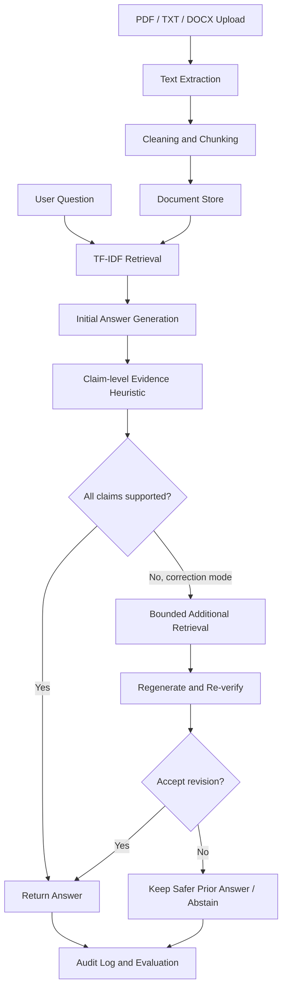

# TrustRAG — Reliable and Self-Correcting RAG Research Prototype

TrustRAG is a student-friendly research prototype for comparing a conventional Retrieval-Augmented Generation (RAG) pipeline with evidence verification and bounded self-correction. It includes a FastAPI backend, a Streamlit interface, local document ingestion, TF-IDF retrieval, an optional OpenAI-compatible generation endpoint, a heuristic evidence verifier, a synthetic smoke-test dataset, exports, and automated tests.

> **Research integrity notice:** the included verifier is a lexical-overlap heuristic, not a validated entailment model. The local generation mode is extractive. The tiny starter dataset is synthetic. This repository is a working prototype scaffold, not a certified reliability system or a publication-ready paper. Do not report the starter metrics as generalizable research findings.

## Research question

To what extent can evidence-based verification and bounded self-correction improve the factual reliability of a RAG system compared with a conventional RAG baseline, and what are the costs in latency and coverage?

## Features

- PDF, TXT, and DOCX ingestion (10 MB upload limit).
- Configurable chunk size and overlap with source metadata.
- TF-IDF retrieval with similarity scores.
- Three modes: baseline, verified, and self-correcting.
- Claim-level heuristic labels and traceable evidence chunk IDs.
- A maximum of two correction attempts by default.
- An explicit insufficient-evidence response when no relevant context is found.
- Streamlit UI and FastAPI endpoints.
- Synthetic evaluation data, CSV/JSON/PNG exports, and pytest tests.
- Optional OpenAI-compatible API configuration; no API key is needed for local extractive demo mode.

## Architecture



## Prerequisites

- Python 3.11 or newer. The code uses ordinary Python features and was initially authored in a Python 3.13 environment; install dependency versions compatible with your operating system.
- Windows, macOS, or Linux.
- Internet access only for installing dependencies or calling an optional hosted generation API.
- No GPU required for local extractive mode.

## Install (Windows PowerShell)

```powershell
cd TrustRAG
py -3.11 -m venv .venv
.\.venv\Scripts\Activate.ps1
python -m pip install --upgrade pip
pip install -r requirements.txt
Copy-Item .env.example .env
```

If Python 3.11 is not installed, use an installed supported version, for example `py -3.13 -m venv .venv`.

## Run the UI

```powershell
streamlit run app.py
```

The Streamlit app opens locally, typically at `http://localhost:8501`. Upload PDF, TXT, or DOCX files on **Knowledge Base**, then ask questions on **Ask AI**.

## Run the API

Open a second terminal with the virtual environment activated:

```powershell
uvicorn src.api.main:app --reload --host 127.0.0.1 --port 8000
```

- Health: `http://127.0.0.1:8000/health`
- Interactive API docs: `http://127.0.0.1:8000/docs`
- Upload: `POST /api/documents/upload`
- Query: `POST /api/query` with `{"question":"How do solar panels generate electricity?","mode":"self_correcting","top_k":4}`

Other endpoints include `GET /api/documents`, `DELETE /api/documents/{document_id}`, `POST /api/index/rebuild`, and the baseline/verified/self-correcting query routes. The evaluation API endpoint currently returns a pointer to the local script rather than launching a long-running job.

## Optional API-backed generation

The API client expects an OpenAI-compatible `POST {LLM_BASE_URL}/chat/completions` endpoint. Set these in `.env`:

```dotenv
LLM_BASE_URL=https://your-provider.example/v1
LLM_API_KEY=your-secret-key
LLM_MODEL=your-model-name
```

Use a provider URL and model that your account actually supports. Never commit `.env`. If the API is configured but unavailable, TrustRAG reports a generation error rather than silently pretending the call succeeded. When all three variables are blank, local extractive mode is used.

## Run tests

```powershell
python -m pytest -q
```

The tests use local fixtures and should not require paid API access. A clean environment may need compatible wheels for scikit-learn and other dependencies.

## Run the starter evaluation

```powershell
python scripts/run_evaluation.py
```

Outputs are written to `reports/`:

- `metric_comparison.csv`
- `evaluation_results.json`
- `metric_comparison.png`

The script resets the runtime document store and loads the included synthetic renewable-energy sample. Back up any runtime data before running it if you have used the same configured data directory for your own documents. The reported metrics are prototype smoke-test summaries only; the starter implementation does not yet provide validated answer correctness, calibrated confidence, robust contradiction detection, RAGAS integration, or statistical significance testing.

## Configuration

Copy `.env.example` to `.env`. Main variables:

| Variable | Default | Meaning |
|---|---:|---|
| `TRUSTRAG_DATA_DIR` | `data` | Runtime data directory |
| `TRUSTRAG_CHUNK_SIZE` | `700` | Approximate character chunk size |
| `TRUSTRAG_CHUNK_OVERLAP` | `100` | Character overlap |
| `TRUSTRAG_TOP_K` | `4` | Initial retrieval count |
| `TRUSTRAG_MAX_CORRECTIONS` | `2` | Bounded correction attempts (capped at 2) |
| `TRUSTRAG_MIN_RELEVANCE` | `0.05` | Minimum TF-IDF similarity to return a chunk |

## Evaluation protocol and metric caveats

The included starter dataset is synthetic and deliberately small. For a research paper, create development and held-out test splits, annotate answerability and evidence spans, compare all three modes on the same questions, and report confidence intervals when sample size permits. Human annotation or independently validated references are needed for defensible correctness claims. Distinguish:

- **Correctness:** whether the answer is factually right relative to a valid reference.
- **Faithfulness:** whether answer claims are supported by the provided context.
- **Retrieval quality:** whether relevant evidence was retrieved.
- **Calibration:** whether predicted confidence aligns with empirical correctness rates.

Current `claim_support_rate` is based on a simple lexical heuristic. It must not be presented as semantic faithfulness or correctness. `answer_coverage` is a basic answer/abstention proxy. API cost is not currently measured. Contradiction detection is not implemented as a dependable semantic capability; the current verifier deliberately does not infer contradiction from low lexical overlap.

## Security and privacy

- Keep credentials in environment variables.
- Uploads are treated as text data; embedded instructions are not trusted system instructions.
- Do not upload sensitive or confidential documents to an untrusted model provider.
- Runtime extracted text is stored locally under `data/runtime/documents.json`; protect or remove it when needed.
- File validation and size limits are included, but this is not a hardened multi-user service. Add authentication, rate limits, isolation, malware scanning, and stronger storage controls before public deployment.

## Known limitations / next research steps

1. Replace TF-IDF with a tested embedding model and vector index for semantic retrieval.
2. Replace lexical verification with a documented NLI model or independent LLM judge, and validate against human-labelled claims.
3. Implement explicit contradiction detection and robust atomic claim extraction.
4. Add RAGAS adapters only after pinning and testing a compatible version and model setup.
5. Implement correct/incorrect answer labels, reference-based metrics, confusion matrices, bootstrap intervals, and suitable statistical tests.
6. Build a larger licensed benchmark and document annotation agreement.
7. Add persistent experiment metadata, user isolation, deletion guarantees, and API evaluation job tracking.
8. Conduct prompt-injection and regression tests.

## Repository map

- `app.py`, `frontend/streamlit_app.py`: Streamlit UI.
- `src/api/main.py`: FastAPI service.
- `src/ingestion/`: file extraction and chunking.
- `src/retrieval/`: TF-IDF retrieval.
- `src/generation/`: extractive and optional API generation.
- `src/verification/`: claim labels, heuristic score, bounded correction controller.
- `src/evaluation/`: dataset loading and summary metrics.
- `data/`: synthetic sample and starter dataset.
- `tests/`: unit and API tests.
- `docs/`: architecture, evaluation protocol, paper draft, experiment log.

## License

MIT License — see `LICENSE`. Third-party model weights, datasets, and APIs may have separate terms.
