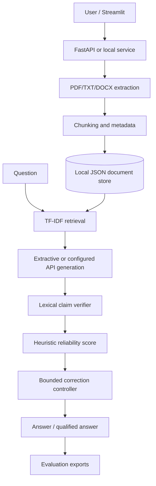

# TrustRAG Architecture

## Design notes

- Retrieval is deliberately replaceable; current retrieval is TF-IDF, not dense semantic search.
- Generation is abstracted behind `LLMClient`; local mode extracts relevant sentences and API mode uses an OpenAI-compatible endpoint.
- Verification and reliability are separate modules. The current verifier is lexical and must not be confused with natural-language inference.
- Correction is bounded to at most two attempts and keeps the previous answer if the revision does not meet the current acceptance heuristic.
- Source identifiers point to stored chunks; page numbers are included when extraction supports them.
- The current JSON store is a single-user prototype, not a concurrent production database.
